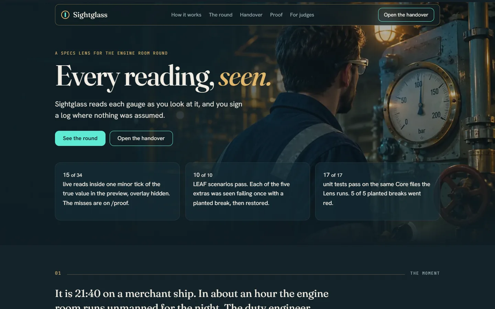
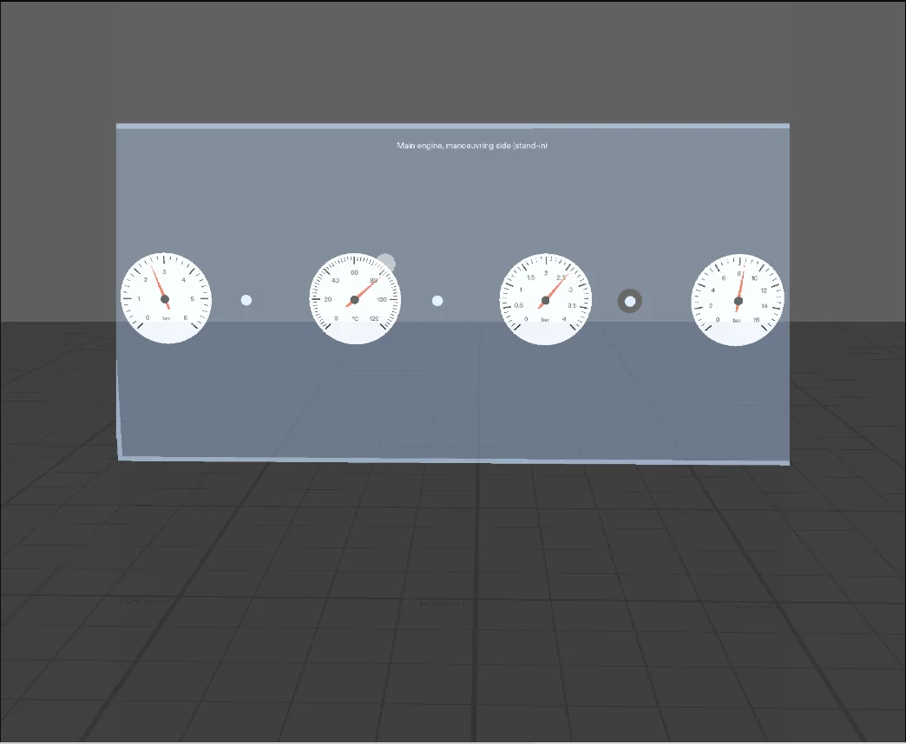
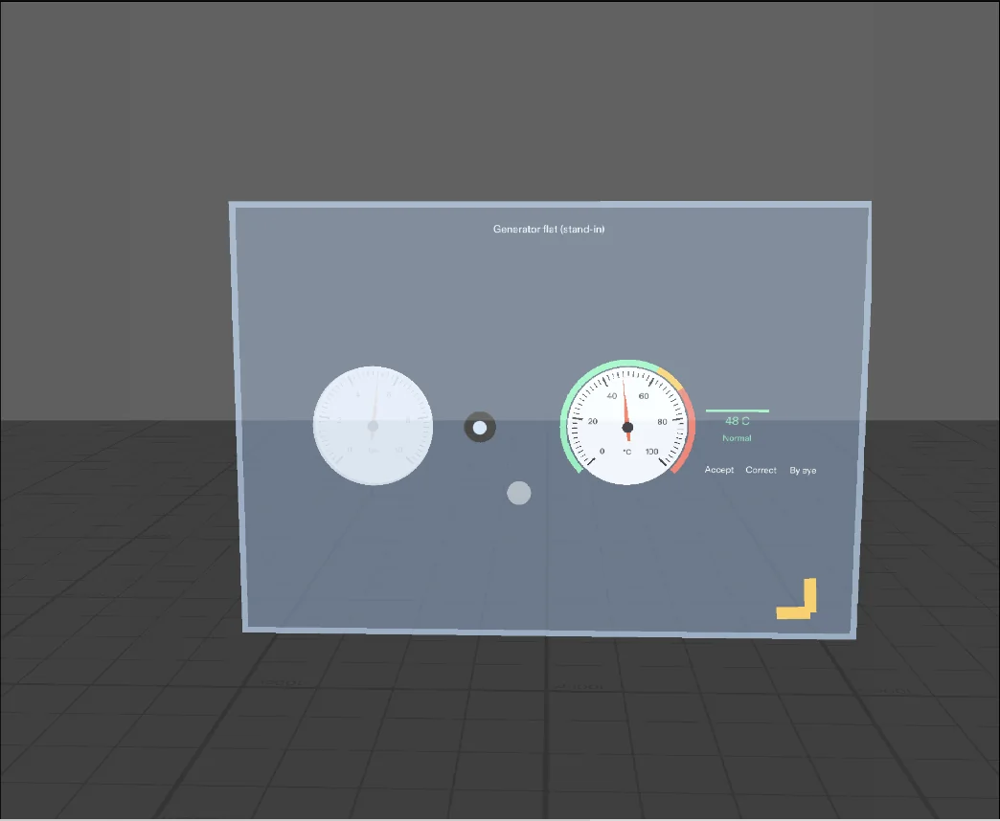
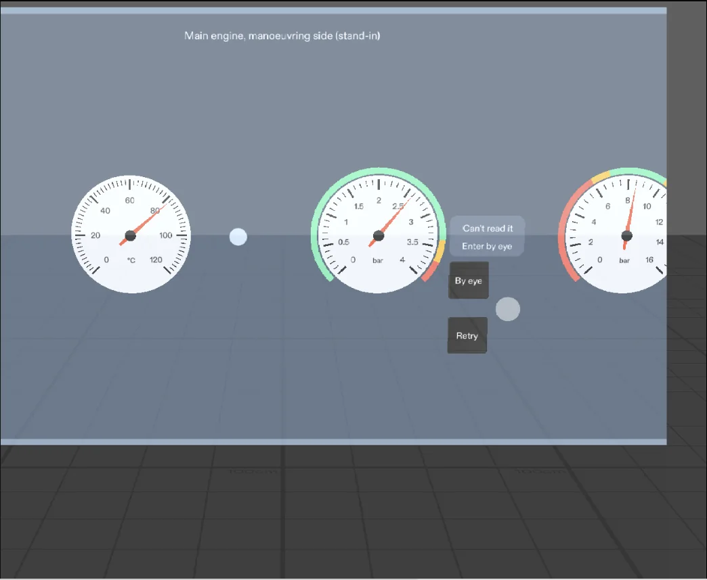
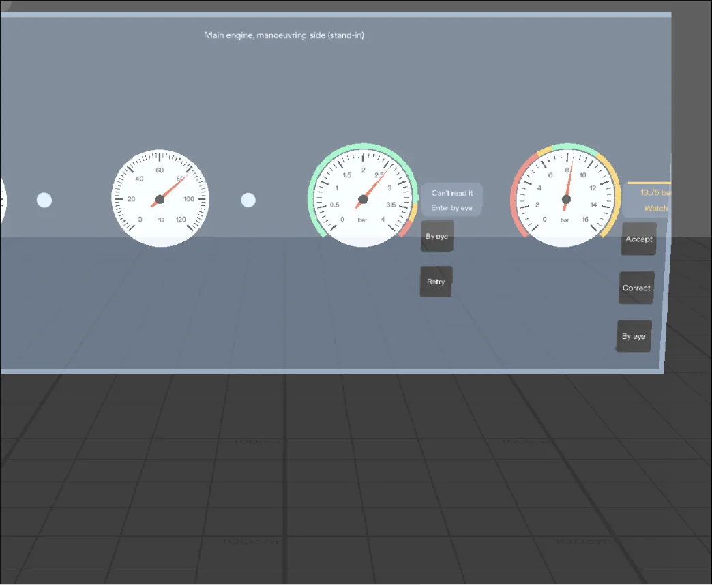
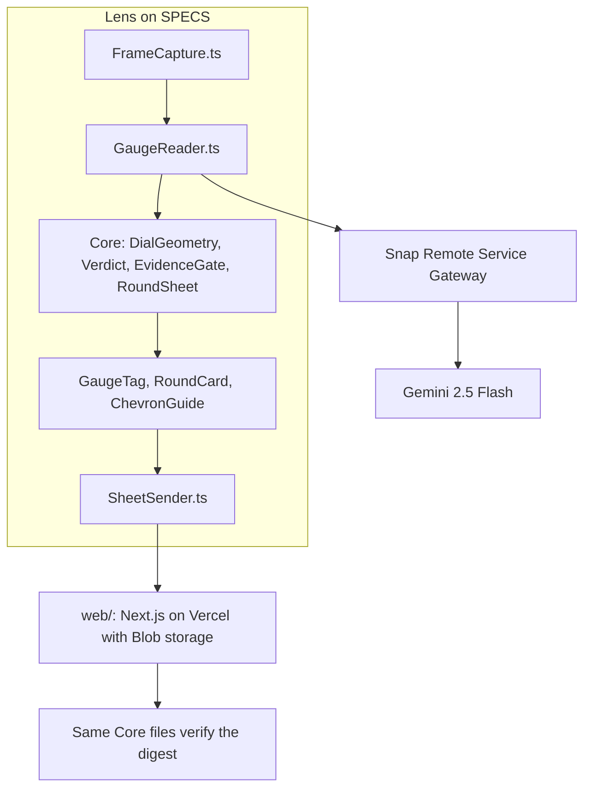
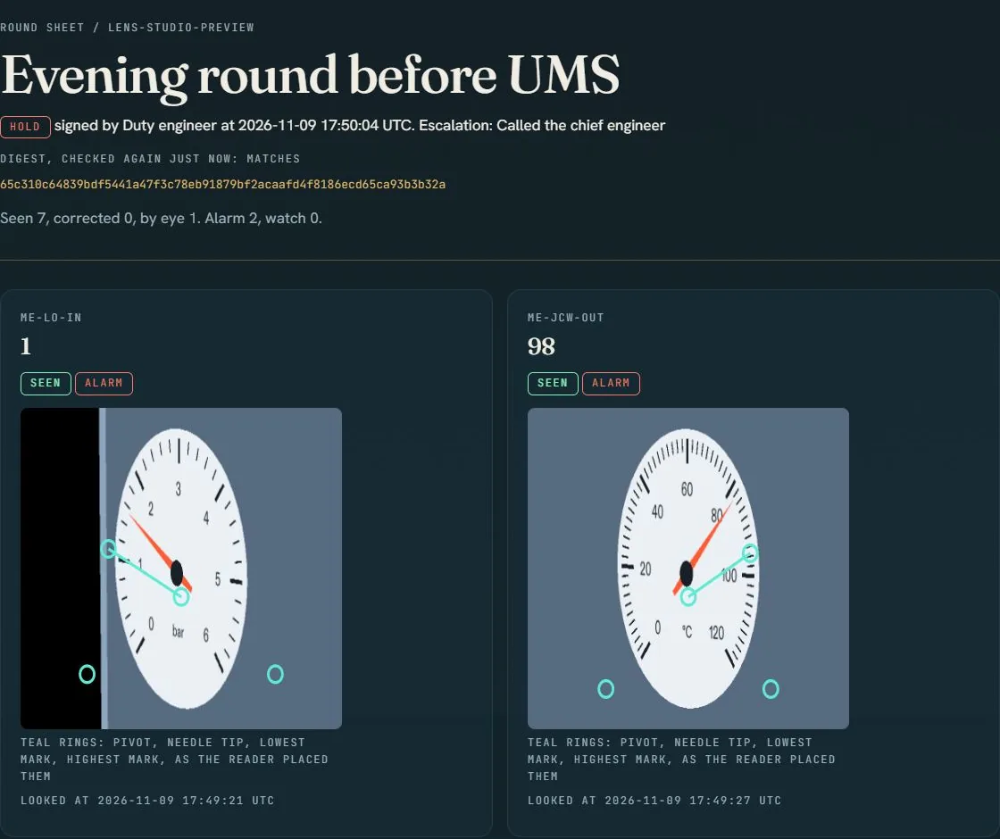

<p align="center">
  
</p>

# Sightglass

**A SPECS Lens for the engine room round. It reads each gauge as the duty engineer looks at it, and the engineer signs a log where every number was seen, not assumed.**

[](https://github.com/0xkinno/sightglass/actions/workflows/checks.yml)
[](LICENSE)

| | |
|---|---|
| Handover door | https://sightglass-kinno.vercel.app (no login; signed round sheets land here and the chief engineer countersigns) |
| For judges | [`docs/JUDGE.md`](docs/JUDGE.md) and the door's `/judge` page: a 60 second, a 3 minute and a 10 minute route |
| Video | https://youtu.be/66xntf96bA4 (2:50): the live door and the Lens Studio preview, with narration |
| Built with | Lens Studio 5.23.2, CLAD and the Lens Studio MCP, LEAF, Spectacles Interaction Kit, Spectacles UI Kit, CameraModule, Remote Service Gateway (Gemini 2.5 Flash), InternetModule |
| Planned with | Devpost Learn `plan-lens`: [`devpost/design-brief.md`](devpost/design-brief.md) |
| Measured | [`docs/FACTS.json`](docs/FACTS.json), written by `scripts/facts.mjs` from the evidence files. Every number below comes from it. |

<table>
  <tr>
    <td width="50%"><br><sub><b>1. Look.</b> Four dials, a dot beside each. Nothing is drawn on a dial until it is read.</sub></td>
    <td width="50%"><br><sub><b>2. A reading.</b> Value, unit and verdict on a tag at the rim. A thin arc marks the normal band. The left glass is fogged.</sub></td>
  </tr>
  <tr>
    <td width="50%"><br><sub><b>3. Can't read it.</b> The Lens says so and offers By eye or Retry. It never shows a guess as a reading.</sub></td>
    <td width="50%"><br><sub><b>4. Decide.</b> Accept, Correct or By eye. Large targets, measured at station distance.</sub></td>
  </tr>
</table>

<sub>Captured in the Lens Studio preview. The machinery space is a stand-in and is labelled so in the scene.</sub>

## The problem

It is 21:40 on a merchant ship. In about an hour the engine room runs unmanned for the night. The duty engineer walks every space and reads every local gauge, a torch in one hand and a rag in the other, then writes each value in the engine log and signs.

When the engineer is rushed, the log can fill up with numbers that were assumed. Nothing in the log says which ones.

| What is true | Source |
|---|---|
| Nearly 60% of hull and machinery fire claims originated in the engine room (claims 2017 to 2024) | [Gard](https://gard.no/insights/engine-room-fires-are-still-a-major-concern/) |
| Pressures and temperatures are recorded in the engine log every watch, and a rushed log can be "filled up in haste with assumed parameters" | [Marine Insight](https://www.marineinsight.com/guidelines/7-important-points-to-consider-while-filling-out-engine-room-log-book/) |
| Before unmanned operation the duty engineer takes a complete round and the checklist is signed and logged | [Marine Insight](https://www.marineinsight.com/guidelines/preparation-for-ums-operation-on-ships/), [ICS checklist B2](https://www.ics-shipping.org/crm_common/assets/resources/ics_erpg2_b_engine_room_checklists_and_permits.pdf) |
| STCW requires a thorough round of the engine room when taking over the watch | [STCW A-VIII/2 part 4-2](https://stcw.maritime.edu/stcw/2025/assessments/OICEW-4-1B) |
| The best vision model tested reads 30.3% of real-world instruments correctly. The common failure is locating the pointer. | [MeasureBench](https://huggingface.co/datasets/FlagEval/MeasureBench), [paper](https://arxiv.org/abs/2510.26865) |

No reply from a serving marine engineer is quoted here. None has been received.

## What it does

| Step | What happens |
|---|---|
| Look | The engineer looks at a gauge. In the preview a pinch on the dot beside it stands for the look. |
| Point | The Lens crops that dial from the camera view and asks Gemini where four things are: the pivot, the needle tip and the two ends of the scale. |
| Measure | Code turns the four points into a value with the scale printed on the round card. The model never supplies the scale or the number. |
| Decide | The engineer accepts, corrects with plus and minus, or reads it by eye. A dial that cannot be read says so. |
| Sign | READY needs every gauge read and none in alarm. HOLD needs the engineer to say who was told. The sheet gets a four character code. |
| Countersign | The sheet reaches the chief engineer, who countersigns the exact digest on screen, with the frames that were seen. |

A reading in alarm turns its tag coral, plays a low two-note cue from the dial, and the round card says the room can't go unmanned. Sign READY stays disabled until the gauge is rechecked or the engineer holds the room and says who was told.

## Explore it in two minutes

1. Watch the [film](https://youtu.be/66xntf96bA4) (2:50).
2. Open the [handover door](https://sightglass-kinno.vercel.app/handover) and open a signed round sheet. The digest line says whether it still matches.
3. Read [`/proof`](https://sightglass-kinno.vercel.app/proof), including the misses.
4. Run the tests: `npm ci && npm test` (17 Core tests).
5. In Lens Studio 5.23.2, open `Sightglass.esproj`, set `scenarioId` on the `InLensRunner` object (for example `extra-pinch-targets`), refresh the preview and read the `LEAF_INLENS` lines in the log.

## How it works

```mermaid
flowchart LR
  A[Engineer looks at a dial] --> B[FrameCapture: crop the composite to the dial rim, overlay off for that frame]
  B --> C[GaugeReader: Gemini 2.5 Flash returns four points as JSON]
  C --> D[Core: angle geometry with the round card scale]
  D --> E[EvidenceGate: engineer accepts, corrects or reads by eye]
  E --> F[Sign READY or HOLD]
  F --> G[SheetSender: POST sheet, digest and frames]
  G --> H[Handover door: digest checked again, chief engineer countersigns]
```





### Where the intelligence is, and is not

| Part | Who decides | File |
|---|---|---|
| Where the needle and the scale ends are | The model | [`GaugeReader.ts`](Assets/Scripts/GaugeReader.ts) |
| Whether the dial is legible | The model says so; a person can still read by eye | [`ReaderContract.ts`](Assets/Scripts/Core/ReaderContract.ts) |
| The scale of the gauge | A person, on the round card. Never the model. | [`RoundPlan.ts`](Assets/Scripts/Core/RoundPlan.ts) |
| The number | Code, from four points and the scale | [`DialGeometry.ts`](Assets/Scripts/Core/DialGeometry.ts) |
| Normal, watch or alarm | Code, from the round card limits | [`Verdict.ts`](Assets/Scripts/Core/Verdict.ts) |
| Whether a value enters the round | A person | [`EvidenceGate.ts`](Assets/Scripts/Core/EvidenceGate.ts) |
| READY or HOLD | A person. Code refuses READY over an alarm. | [`EvidenceGate.ts`](Assets/Scripts/Core/EvidenceGate.ts) |
| Whether a sheet changed after signing | A digest, checked again by the door with the same code | [`RoundSheet.ts`](Assets/Scripts/Core/RoundSheet.ts) |

## Why it belongs on glasses

| Strength | Where this build uses it |
|---|---|
| Shares your view | The evidence is the camera frame of what the engineer is looking at. A phone needs a free hand and a photo per gauge. |
| Draws in the world | A tag at each dial rim, a thin arc for the normal band, a chevron at the edge of view toward the next gauge with a soft click from its direction. |
| Leaves your body free | A reading happens on a look. The only inputs are large pinch targets. |

## Planned with plan-lens, built with CLAD

The design brief [`devpost/design-brief.md`](devpost/design-brief.md) was written with the `plan-lens` skill from the owner's own answers and approved before any scene work. The Lens was built in Lens Studio through the CLAD agent skills (`specs-camera`, `specs-ai-remote-service`, `verify-preview`, `specs-leaf-run-in-preview`) and the Lens Studio MCP tools, and tested with LEAF. [`devpost/BUILD_LOG.md`](devpost/BUILD_LOG.md) is generated from the local session logs: 7 Claude Code sessions and 327 Lens Studio MCP tool calls. Minutes in it include idle time, so it does not claim a build duration.

| Phase | Result |
|---|---|
| P0 platform probe | Gateway call, composite crop, vision JSON and internet fetch all pass in the preview: [`PLATFORM_PROBE.md`](devpost/evidence/PLATFORM_PROBE.md) |
| P1 plan | [`design-brief.md`](devpost/design-brief.md), approved |
| P2 Core | 17 unit tests, same files the Lens runs |
| P3 scene and flow | Three stations, eight dials, tags, round card, chevron, sign flow |
| P4 perception | Live reads through the gateway, measured against the plant simulator: [`FINDINGS.md`](devpost/FINDINGS.md) |
| P5 LEAF and breaks | 10 scenarios, one planted break per extra scenario |
| P6 handover door | Deployed, round sheets accepted and countersigned |
| P7 wild-set evaluation | Pre-registered, not run (see Measured) |

## What it will not do

| Refusal | Enforced in | Tested by |
|---|---|---|
| Put a value in the round that nobody looked at | `EvidenceGate.ts` | `tests/core.test.ts`, LEAF `extra-fault-reader` |
| Sign READY with a reading in alarm | `EvidenceGate.ts` `canSign` | `tests/core.test.ts`, LEAF `c2` |
| Take the scale from the model | `RoundPlan.ts`, `EvidenceGate.ts` `propose` | `tests/core.test.ts` |
| Show a guess when the dial cannot be read | `EvidenceGate.ts` `propose` | LEAF `c3` |
| Say a sheet was sent before the door answered 200 or 201 | `SightglassMain.ts` `sendSheet` | LEAF `extra-send` |
| Let its own overlay into the captured frame | `FrameCapture.ts` | LEAF `extra-overlay-hidden` |

## Measured

All values below are read from [`docs/FACTS.json`](docs/FACTS.json). The room, the gauges and the plant are stand-ins in the Lens Studio preview, so this measures the reading path, not a ship.

**Live reads against the plant simulator** (8 gauges, 5 captures each with the overlay hidden, plus 3 each with it shown; error in minor ticks, one tick is the smallest printed division):

| Run | Captures | Read | Median error | Mean error | Within 1 tick | Within 2 ticks | Median time |
|---|---:|---:|---:|---:|---:|---:|---:|
| Shipped configuration, overlay hidden | 40 | 34 of 35 legible | 1.25 | 2.71 | 15 | 18 | 3243 ms |
| Shipped configuration, overlay shown | 24 | 20 of 21 legible | 1.1 | 2.79 | 9 | 11 | 3377 ms |
| Tried: extra scale hint line, overlay hidden (not adopted) | 40 | 32 of 35 legible | 2.24 | 3.3 | 8 | 16 | 3338 ms |

**Per gauge, overlay hidden:** the model's own number against the number code computes from the points it places.

| Gauge | Reads | Mean error from points (ticks) | Mean error of the model's own number (ticks) |
|---|---:|---:|---:|
| ME-LO-IN | 5 | 1.02 | 0.37 |
| ME-JCW-OUT | 5 | 5.7 | 0.9 |
| ME-SCAV | 5 | 4.91 | 0.03 |
| FO-SUP | 5 | 0.92 | 0.91 |
| SW-PUMP | 4 | 0.93 | 0.68 |
| AIR-START | 5 | 4.22 | 0.29 |
| AE1-LO | 4 | 0.93 | 0.93 |
| STG-OIL | 5 | 0.92 | 0.77 |

**The misses, plainly.** Three gauges carry a steady bias of 4 to 6 ticks when the value is computed from the points, while the model's own number for them is within about one tick. The pointing step is the weak part and is not fixed. One gauge crossed into ALARM from a wrong point read in 4 of 5 captures. A person has to accept every reading, and the tag shows the number and the verdict word, but the gate cannot catch a wrong number a person agrees with. The fogged dial in the stand-in scene is too light: it was flagged unreadable in 1 of 5 captures, so the legibility gate was not properly exercised. Overlay hidden or shown made no difference this set of captures can show; hiding it stays because it costs a few frames and removes the risk. The gateway response carries no usage count, so tokens per read are not recorded.

**Tests.**

| What | Result | File |
|---|---|---|
| Core unit tests | 17 pass | `tests/core.test.ts` |
| LEAF scenarios on the fixture reader | 10 of 10 pass | [`leaf-p5-suite.log`](devpost/evidence/leaf-p5-suite.log) |
| Planted breaks, one per extra scenario | 5 went red and came back to green | [`break-proofs.log`](devpost/evidence/break-proofs.log) |
| c1 in live mode | Failed: the model put the scale-end marks on the wrong sides. The log is kept. | [`leaf-p5-suite.log`](devpost/evidence/leaf-p5-suite.log) |
| Pinch targets at station distance | 39 measured, 0 below the limits | LEAF `extra-pinch-targets` |
| Signed round posted to the door | HTTP 201, read back with a matching digest; a forced 500 shows Not sent | LEAF `extra-send` |
| Web door | 324 checks pass: 6 viewports x 5 pages, no overlap, no horizontal scroll, no serious accessibility violations, no console errors | `web/tests/viewports.mjs` |

**Wild set.** An evaluation on real dial photos, point against read, is pre-registered in [`eval/PREREGISTRATION.md`](eval/PREREGISTRATION.md), with the selection hash committed before any model call. It is not finished, so no figure is claimed. The pre-registered model is no longer served to the API key used, and the replacement the API names did not answer. Amendment 1 moves both arms to a model that did answer, so the result will describe the method with a different model than the product uses. The run was started and is slow, and partial output is not summarised anywhere until it completes.

**The door shows what the reader saw.** The handover sheet draws the four points the reader placed on the crop that was sent. Below is a real round, sent from the Lens in live mode, as the chief engineer sees it. It also shows the weakness plainly: the lowest and highest mark rings sit below the dial, not on its scale ends.

<p align="center"></p>

## Snap's SPECS guidance, measured

| Item | Value in this build |
|---|---|
| Pinch targets | Dot 5 cm, decision buttons 4.8 by 4.6 cm. Every target at least 2 degrees across and every gap at least 1 degree, at station distance (122 to 163 cm). Tags are scaled with distance (1.0 to 1.36). |
| Button layout | A column of three under the tag with 2.2 cm gaps. A row did not fit between two dials at those sizes. |
| Placement | Stations at 120, 150 and 160 cm. The round card sits 80 cm away, 12 cm left and 34 cm below the eye line. |
| Display | Additive: dark renders as transparent, so plates and dots are light. The stock dark button faces were invisible and are covered by light discs. |
| Versions | Lens Studio 5.23.2, Spectacles Interaction Kit 2.0.0, UI Kit 2.0.0, Remote Service Gateway 0.2.0, LEAF 2.0.2. Preview device SPECS 27. |

## What is live, what is a stand-in

| Part | Status |
|---|---|
| Stations, dials, plant values | Stand-in, built for the preview and labelled in the scene |
| Pinch on the dot beside a gauge | Stands for looking at the gauge |
| Camera crop of the composite frame | Live (`FrameCapture.ts`) |
| Model call through Remote Service Gateway | Live (`GaugeReader.ts`) |
| Geometry, verdicts, evidence gate | Live, the same files the unit tests run |
| Sending the signed sheet, with the crops and the reader's points | Live, to the handover door (`SheetSender.ts`) |
| Round card limits | An example round card, not a real ship's |
| Alarm and click sounds | Plain synthesised tones |

## What I learned

I assumed the hard part would be getting a model to look at a dial. The hard part was that the picture it looks at is not the picture I thought. The composite frame in the SPECS preview is squashed to half its width, so every dial arrives as an ellipse, and the first live reads were wrong in a way that looked like the model's fault. Measuring the squash and undoing it before the geometry runs fixed that part and left the real problem visible.

The real problem is pointing. Asked for four positions, the model places them roughly, and on three gauges it places them consistently wrong. Asked for the value directly, the same model is close. That cuts against the design this project is built on, and I have left the numbers on the page rather than the claim off it. The refusal rules still hold: a wrong number never reaches the log without a person accepting it. But that protection is only as good as the person's eyes.

The tests taught me the most. A scenario that has never failed proves nothing, so each extra scenario has a planted break that turned it red. The pinch-target scenario found targets that were too small and a slider that silently changed a size. I also found that the card said Sent before anything was sent, and wrote a scenario so that cannot come back.

## Run it

```bash
npm ci
npm test                      # 17 Core tests
node scripts/facts.mjs        # rewrites docs/FACTS.json from the evidence files
node tools/check_repo.mjs     # house style and secret checks
cd web && npm ci && npm run build && npm start      # the handover door on :3000
```

To run the Lens, open `Sightglass.esproj` in Lens Studio 5.23.2 with the preview on Interactive input and device SPECS 27. Live reads need Remote Service Gateway tokens: use the token plugin in Lens Studio (signed in to Snapchat) and write them to the `RemoteServiceGatewayCredentials` component. They expire in about an hour. The committed scene holds placeholders. The reader mode is `fixture` by default so the tests are deterministic; set it to `live` to call the model.

The headless browser check of the door: `cd web && node tests/viewports.mjs http://localhost:3000 --shots`.

## Disclosures, licence, references

Disclosures are in [`docs/DISCLOSURES.md`](docs/DISCLOSURES.md), third party notices in [`docs/THIRD_PARTY_NOTICES.md`](docs/THIRD_PARTY_NOTICES.md), the build log in [`devpost/BUILD_LOG.md`](devpost/BUILD_LOG.md), and the SDK surface with file and line in [`docs/SDK_SURFACE.md`](docs/SDK_SURFACE.md). Licence: MIT.
